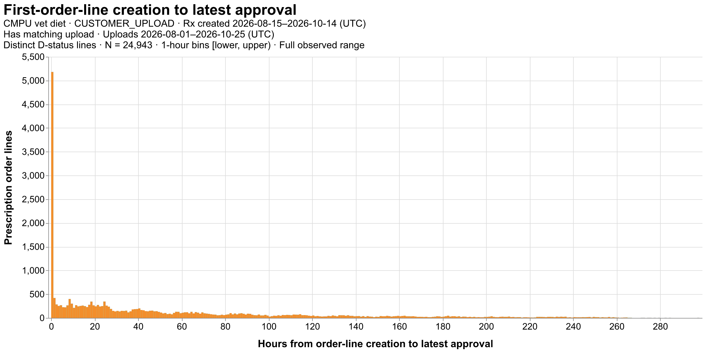
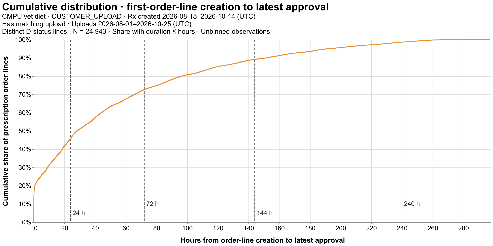

# First-order-line approval distribution

CMPU vet diet · CUSTOMER_UPLOAD · Rx created 2026-08-15–2026-10-14 (UTC)

Has matching upload · Uploads 2026-08-01–2026-10-25 (UTC)

MAX_APPROVED_DATETIME − ORDER_LINE_CREATED_DTTM, hours. Both first-order keys matched; one count per distinct order/order-line pair, current line status D. Shipment rows collapsed using latest populated approval. Require a matching DIET_PRESCRIPTION upload entity by expanded RX_ID and numeric CUSTOMER_ID. No file-presence or upload-before-approval requirement. Both timing endpoints required; no approval-date filter. Negative durations and outliers retained. Bins are [lower, upper); quantiles use unbinned hours with linear interpolation. Association and distinct-line audit counts have separate denominators; missing endpoints are not zero. Extracted at 2026-10-27T20:56:07.178837+00:00.

