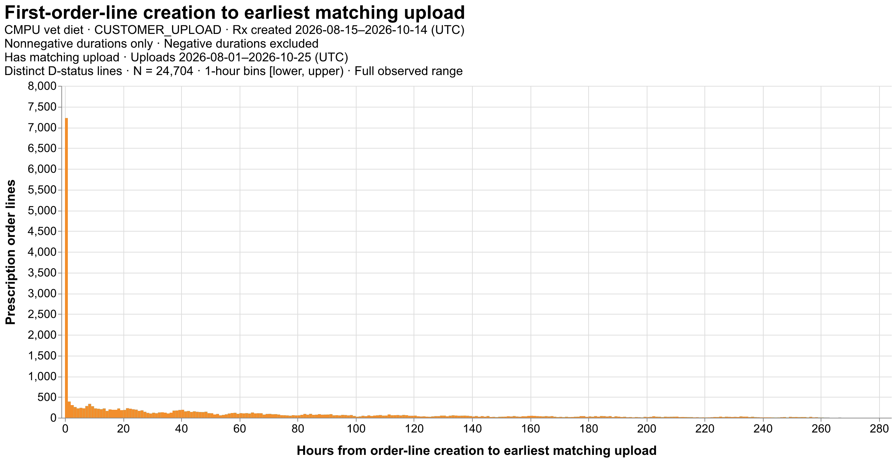
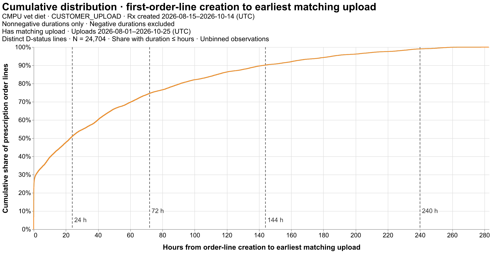

# First-order-line upload distribution

CMPU vet diet · CUSTOMER_UPLOAD · Rx created 2026-08-15–2026-10-14 (UTC)

Nonnegative durations only · Negative durations excluded

Has matching upload · Uploads 2026-08-01–2026-10-25 (UTC)

Earliest matching upload CREATED_TS_UTC − ORDER_LINE_CREATED_DTTM, hours. Earliest upload is within the stated upload search window. Approval timestamp is not required. Both first-order keys matched; one count per distinct order/order-line pair, current line status D. Shipment rows collapsed to consistent line-creation timestamps. Require a matching DIET_PRESCRIPTION upload entity by expanded RX_ID and numeric CUSTOMER_ID. No file-presence or upload-before-approval requirement. Both timing endpoints required; no approval-date filter. Negative durations excluded from histogram and statistics; retained in details and eligibility audit. All nonnegative outliers retained. Bins are [lower, upper); quantiles use unbinned hours with linear interpolation. Association and distinct-line audit counts have separate denominators; missing endpoints are not zero. Extracted at 2026-10-27T20:58:05.129083+00:00.

