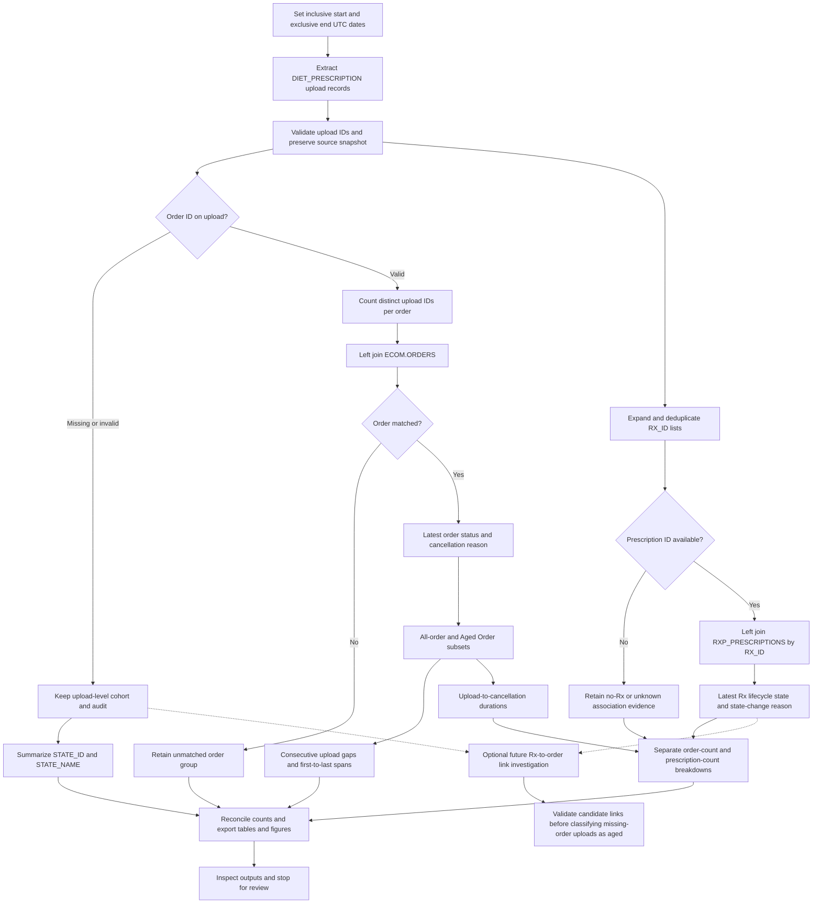

# Vet-diet upload analysis: implementation plan

## Goal and scope

Make the upload, order and prescription analyses reproducible from a common dated upload snapshot. Default to July 30–October 20, 2026 UTC, with inclusive start and exclusive end parameters. Select `UPLOAD_TYPE = 'DIET_PRESCRIPTION'` across customer channels. Do not require `HAS_ASSOCIATED_RX`, `HAS_UPLOADED_FILE` or an associated resource type. Profile those fields instead. CMPU is interpreted as this observed customer-upload population, not a literal source-field value.

## Verified distinction

The refreshed snapshot has 147,125 uploads: 115,467 have valid order IDs and 31,658 lack order IDs. All 31,658 missing-order uploads currently have upload state `7 / ACCEPTED`, `HAS_ASSOCIATED_RX = TRUE`, and exactly one distinct prescription ID each. These are upload-record associations; this check did not establish a prescription-to-order link. An accepted upload is not necessarily an approved prescription. Missing-order uploads cannot yet be classified as aged orders.

## Workflow
Aere

## Implementation steps

1. **Shared extract and provenance.** Add a reproducible `analyze-vet-diet-upload-workflow` Make target with `START_DATE`, `END_DATE`, `CACHED=1` and `PRINT_SQL=1`. Keep existing analysis targets available. Extract upload IDs, raw order IDs, Rx ID lists, upload timestamps, client/source, upload states and association flags. Save SQL, snapshot timestamps, dates and query/cohort fingerprints under `data/`. Invalidate dependent caches when the source query or cohort changes.
2. **Separate grains.** Maintain a unique-upload table, a distinct order/upload bridge and a distinct upload/prescription bridge. Reject conflicting duplicate source keys. Normalize valid numeric order IDs; report missing and invalid IDs separately. Count uploads before Rx expansion so multi-prescription uploads cannot inflate counts. Preserve orders and uploads without prescriptions.
3. **Order analyses.** Left-join `ECOM.ORDERS` by the upload's order ID; retain unmatched orders. Use source `ORDER_STATUS_DESCRIPTION`, retain `ORDER_STATUS`, and identify aged orders using normalized `ORDER_CANCEL_REASON = 'Aged Order'`. Calculate distinct uploads per order, consecutive gaps ordered by upload timestamp then upload ID, and first-to-last spans for orders with multiple uploads. All durations use only uploads inside the selected window.
4. **Cancellation analyses.** Validate the UTC interpretation of cancellation timestamps against the Eastern companion. At order grain use the earliest qualifying upload; at prescription grain use each prescription's selected upload under the existing deduplication rule. Preserve signed durations. Publish separate denominators, histograms and quantiles; never substitute an order's first upload for a prescription's selected upload.
5. **Association and status analyses.** Keep flag-confirmed association, usable Rx IDs and matched prescription records separate. Use any positive evidence across an order's qualifying uploads for the associated group; require false flags and no IDs for no-Rx; retain unknown/conflicting evidence. Left-join Rx IDs to `RXP_PRESCRIPTIONS` and report latest lifecycle state/reason. Order-level mixed values remain explicit; prescription-level figures count each Rx individually.
6. **Missing-order branch.** Export upload state, timestamp, Rx IDs and flags for missing/invalid-order uploads independently. Do not exclude them from upload totals or assign inferred order outcomes. A future Rx-to-order investigation must verify authoritative relationship fields, handle one-to-many candidates and compare dates; it is not part of the direct-order-link implementation.
7. **Outputs and review.** Save Markdown summaries and upload/order/prescription details under `outputs/tables/`, transparent Altair PNGs under `outputs/charts/`, and the workflow source/render under `outputs/diagrams/`. Update HOWTO and todo records. Keep timestamps and grain definitions visible. Stop for user review before committing.

## Validation and acceptance

- Distinct uploads reconcile to valid-order, missing-order and invalid-order populations. Unique uploads per order sum to the valid order/upload bridge count.
- For each multi-upload order, adjacent gap count equals upload count minus one; gaps sum to its first-to-last span. Retain zero gaps and deterministic timestamp ties.
- Test absent Rx IDs, false/NULL flags, flag/ID contradictions, repeated uploads, multiple Rx IDs, duplicate join records, missing states and unmatched orders.
- Order-state and Rx-state group totals reconcile to their explicit denominators; no missing-order upload is classified as aged through an unverified link.
- Cached runs make no warehouse calls and reject mismatched provenance; fresh and cached results agree for the same snapshot.
- Inspect chart labels, shared bins where comparisons require them, and count conservation. Latest statuses are snapshots, not guaranteed terminal outcomes or historical status at upload/cancellation.

This is a plan to consolidate existing analyses and make the supplementary gap/state exports reproducible. It does not authorize guessing Rx-to-order links or implementing that optional investigation.
