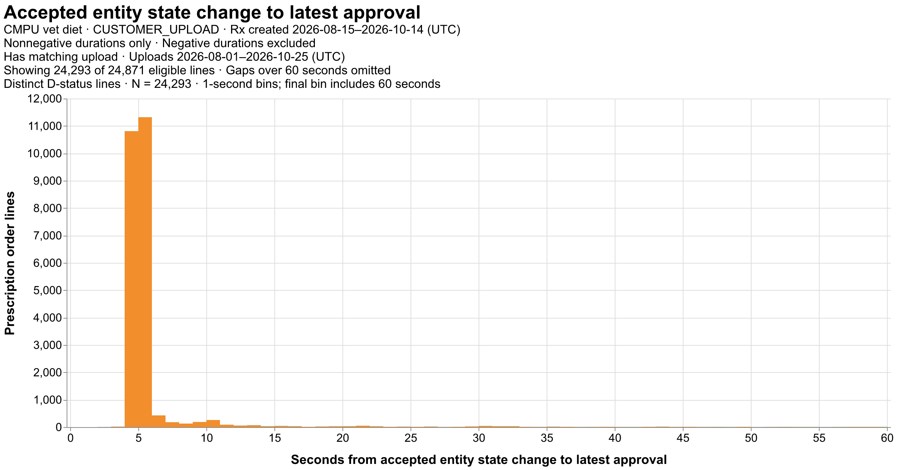
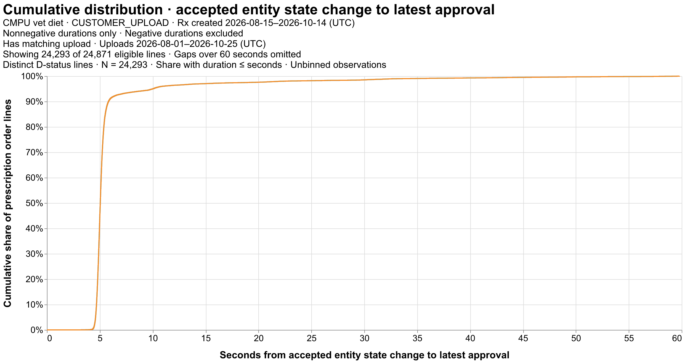

# First-order-line upload-to-approval distribution

Plots show only gaps from 0 through 60 seconds; their CDF is normalized to that subset. Full-range statistics and data remain exported. Only current ACCEPTED entities qualify. Select earliest entity creation, with UPLOAD_ID ties; CMPU vet diet · CUSTOMER_UPLOAD · Rx created 2026-08-15–2026-10-14 (UTC)

Nonnegative durations only · Negative durations excluded

Has matching upload · Uploads 2026-08-01–2026-10-25 (UTC)

MAX_APPROVED_DATETIME − selected accepted entity STATE_CHANGED_TS_UTC, hours. Entity creation is within the stated search window; state-change time is unrestricted. Both endpoints required. Both first-order keys matched; one count per distinct order/order-line pair, current line status D. Shipment rows collapsed using latest populated approval. Require a matching ACCEPTED DIET_PRESCRIPTION upload entity by expanded RX_ID and numeric CUSTOMER_ID. No file-presence or upload-before-approval requirement. Both timing endpoints required; no approval-date filter. Negative durations excluded from histogram and statistics; retained in details and eligibility audit. All nonnegative outliers retained. Bins are [lower, upper); quantiles use unbinned hours with linear interpolation. Association and distinct-line audit counts have separate denominators; missing endpoints are not zero. Extracted at 2026-11-04T13:35:51.236919+00:00.

