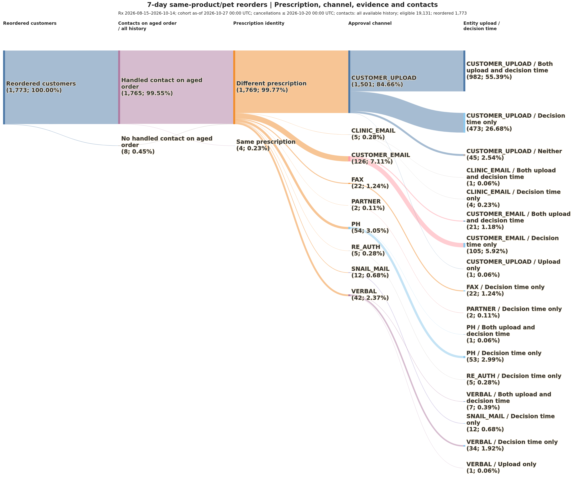

# Reorder prescription Sankey

Original CMPU vet-diet CUSTOMER_UPLOAD prescriptions created [2026-08-15, 2026-10-15) UTC. As-of 2026-10-27 00:00 UTC. Exact same CUSTOMER_ID, PRODUCT_ID and known unambiguous PET_ID; different order placed strictly after aged cancellation through the horizon endpoint inclusive. Each horizon has its own complete-follow-up population. Placed attempts count regardless of shipment/status. Each customer counts once per horizon using their minimum qualifying elapsed nanoseconds; ties use earlier reorder timestamp then reorder order/line and original order/line IDs. This is not necessarily their chronologically first reorder. Prescription identity uses RX_ID, not RX_USAGE_ID. Missing/partial evidence is Unknown; multiple IDs are separate. Only Different prescription customers branch into approval channels. Same and unresolved categories skip the channel and upload/decision stages. Diagram percentages use reordered customers; channel tables also show within-Different percentages. Customers without reorders are outside the Sankey. Prescription associations and approval channels reflect current enrichment-time evidence, not guaranteed historical values at placement.

Frozen cohort SHA-256 73bbc6124114e89ae59bdf21f0a91680920437f1818f8ecb40bc96a3896461db; enrichment SHA-256 36cb5192eddff4d300889e7f7dcbdd098face71fd99965ff31420cc0cc144363; extracted 2026-10-27T17:43:16.917509+00:00.

Final stage partitions each approval channel into Both upload and decision time, Upload only, Decision time only, or Neither. Upload means a matching DIET_PRESCRIPTION entity by RX_ID/customer created through 2026-10-27 00:00 UTC inclusive; undated entities are not counted as dated uploads. Entity presence does not prove a file upload. Decision time means non-null MIN_APPROVED_DENIED_DATETIME on the selected reordered line, collapsing shipment rows to the earliest populated minimum. This is current non-null evidence, including minima after the cutoff. Right-hand nodes retain their approval channel. All node percentages use reordered customers, and the diagram counts customers rather than distinct prescriptions. Evidence SHA-256 c7f099769e32f52aa6c99d3c963ebc6d4f2c3c065a74cdf8d4e4ef6b50eb4f08; extracted 2026-10-27T18:02:26.691343+00:00.

All handled contacts are an additional categorical partition of ALL selected reordered customers, including Same/unresolved prescription categories. Join FCT_CONTACTS_BRD on original aged ORDER_ID with HANDLED_FLAG=TRUE without any CATEGORY_WISMO_FLAG filter (true, false and null categories retained); apply NO contact timestamp filter: include contacts before cancellation, at boundaries, after reorder, after the cohort cutoff and with missing timestamps. The contact timestamp is interpreted as UTC and converted to UTC. Sankey weights are customers with/without a qualifying contact, not the COUNT(*) contact-leg totals. First/last timestamps, distinct sessions and channel details are retained in contact exports. Contact presence covers all available lookup-time aged-order history, not only contacts known before reorder or the cohort cutoff; undated contacts count as present. The partitions are categorical, not a chronological ordering of prescription/upload/decision/contact events. Contact SHA-256 3b4f3f7144b9575880a15efbd14a22ea675c500373ec071771366317efb0c80f; extracted 2026-10-27T19:00:50.896049+00:00.

Contact presence is immediately after Reordered customers, followed by prescription identity, approval channel and upload/decision evidence. Contact branches merge into the identity categories; later channel/evidence nodes show overall totals.

Diagram: outputs/diagrams/2026-08-15_2026-10-14/aged-order-reorder-prescription-sankeys_customer_upload_same-pet_reorders-7d-14d-21d_as-of-2026-10-27_with-upload-decision-evidence_with-all-handled-contacts-all-history-UTC_7d-prescription-identity-approval-channel.png. Mermaid source: src/diagrams/2026-08-15_2026-10-14/aged-order-reorder-prescription-sankeys_customer_upload_same-pet_reorders-7d-14d-21d_as-of-2026-10-27_with-upload-decision-evidence_with-all-handled-contacts-all-history-UTC_7d-prescription-identity-approval-channel.mmd.

