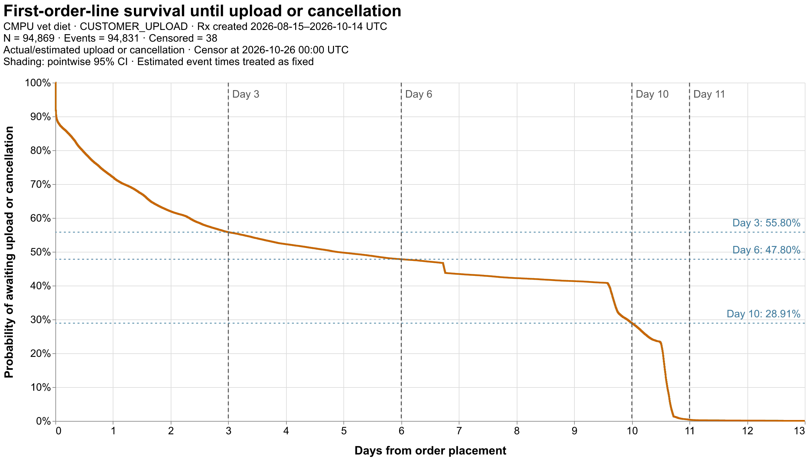

# First-order-line survival

Prescriptions UTC [2026-08-15, 2026-10-15); uploads UTC [2026-08-01, 2026-10-26).

One observation per audited REFNUM 20 distinct order/order-line pair; all statuses and flags. Time zero is ORDER_PLACED_DTTM. Observed upload means the selected ACCEPTED entity STATE_CHANGED_TS_UTC. Event is the earlier of actual/estimated acceptance and cancellation, including ties. The fixed 0.96 estimate is retained pending recalibration and treated as an event time. S(t) is the probability that neither accepted-entity state change nor cancellation has occurred by elapsed day t; it is not an upload-completion probability. Right censor missing or later events at 2026-10-26T00:00:00+00:00; an event exactly at cutoff is observed. Exclude missing placement, placement after cutoff and negative event durations from the curve; preserve them in line details. Zero durations are included. Kaplan–Meier uses events before censoring for equal durations and no extrapolation beyond follow-up. The shaded band is a pointwise 95% log-log Greenwood confidence interval conditional on supplied event times; it does not capture uncertainty from the 0.96 estimation rule. Independent right censoring is assumed. The PNG shows days 0–13 with vertical markers at days 3, 6, 10 and 11 and labeled horizontal guides for S(3), S(6) and S(10); the curve table retains full follow-up. For PNG rendering only, retain the first and last exact step in each horizontal output-pixel bin; the exported curve retains every step.

Source extracted 2026-11-04T13:38:33.142995+00:00; source SHA-256 d6fb94a19a32bc361c152190c7b86a1e24f4e59dd3f3433a10decdbb2800c8af. Estimator reference: https://www.statsmodels.org/stable/duration.html

| measure | count |
| --- | --- |
| Prescriptions | 104307 |
| Unmatched prescription associations | 9201 |
| Distinct matched lines | 95106 |
| Source negative durations (overlapping quality flag) | 236 |
| Included | 94869 |
| Negative event duration | 198 |
| Placement after cutoff | 39 |
| Event | 94831 |
| Excluded | 237 |
| Censored: missing event | 24 |
| Censored: event after cutoff | 14 |
| Included event source: actual_upload | 25142 |
| Included event source: estimated_upload | 67494 |
| Included event source: order_cancellation | 2195 |
| Included event source: tie | 0 |
| Included event source: missing | 0 |
